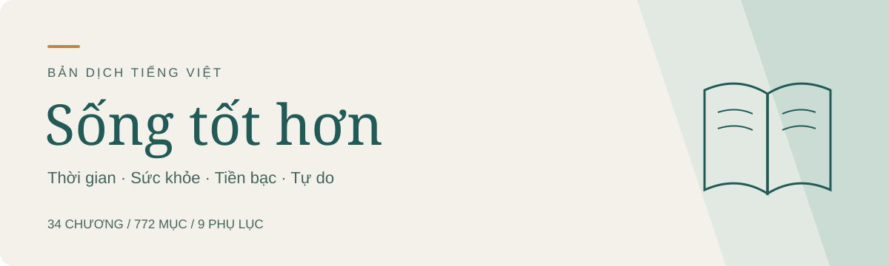

  
  
<strong>Cân nhắc thời gian, sức khỏe, tiền bạc và tự do.</strong>

  
Bản dịch tiếng Việt độc lập của <em>高性价比人生指南</em> · <a href="https://github.com/eternity4719/HowToLiveBetter">HowToLiveBetter</a>

  

    
    
    
  

  
<a href="book/00-loi-mo-dau.md"><strong>Đọc từ đầu</strong></a> · <a href="PROGRESS.md"><strong>Mục lục đầy đủ</strong></a> · <a href="https://github.com/phucledien/how-to-live-better-vi/releases/tag/v0.1.0"><strong>Tải sách</strong></a>

---

## Một bản tiếng Việt để đọc, hiểu và cân nhắc

Cuốn sách tập hợp những lựa chọn thường gặp trong cuộc sống: giữ sức khỏe, sử dụng tiền và thời gian, đi làm, chăm sóc gia đình, xử lý tình huống khẩn cấp và tránh các rắc rối pháp lý. Mỗi mục trình bày chi phí, ý chính, lợi ích, mức độ bằng chứng, nguồn tham khảo và điều cần lưu ý.

Bản dịch hướng đến **tiếng Việt tự nhiên, dễ đọc**, có thể đổi cách diễn đạt để giữ đúng ý. Số liệu, mức độ chắc chắn và bối cảnh của nguồn được giữ lại. Những bổ sung dành cho độc giả Việt Nam có nhãn riêng để bạn phân biệt với nguyên tác.

| Đã chuyển ngữ | Quy mô |
| :--- | ---: |
| Chương chính | **34 / 34** |
| Mục nội dung | **772 / 772** |
| Bài bổ sung | **9 / 9** |
| Định dạng tải về | **Markdown · EPUB · PDF** |

> **Trạng thái v0.1.0:** Bản thảo dịch đầy đủ, có hỗ trợ AI và đã tự đối chiếu. Chưa được thẩm định y khoa, pháp lý độc lập toàn bộ. Luật, thủ tục và số liệu của Trung Quốc vẫn được ghi đúng bối cảnh; không mặc nhiên áp dụng tại Việt Nam. Xem [những điểm cần rà soát tiếp](editorial/REVIEW_PRIORITIES.md).

## Tải bản đầu tiên

| Định dạng | Phù hợp khi bạn muốn | Tải về |
| :--- | :--- | :--- |
| **EPUB** | Đọc trên điện thoại hoặc máy đọc sách; đổi cỡ chữ theo ý thích | [Tải EPUB](https://github.com/phucledien/how-to-live-better-vi/releases/download/v0.1.0/Song-tot-hon-vi-ban-nhap.epub) |
| **PDF** | Đọc với bố cục trang cố định, mục lục số trang và bookmark | [Tải PDF](https://github.com/phucledien/how-to-live-better-vi/releases/download/v0.1.0/Song-tot-hon-vi-ban-nhap.pdf) |
| **Markdown** | Tìm kiếm, ghi chú hoặc biên tập toàn bộ nội dung | [Tải Markdown](https://github.com/phucledien/how-to-live-better-vi/releases/download/v0.1.0/Song-tot-hon-vi-ban-nhap.md) |

EPUB có phông tiếng Việt nhúng và tự dàn theo màn hình. PDF dùng khổ sách 170 × 240 mm, có số trang và liên kết điều hướng. Các bảng rộng được chuyển thành từng nhóm thông tin để đọc thuận tiện trên trang hẹp.

[Chi tiết bản phát hành và dấu kiểm SHA-256 →](https://github.com/phucledien/how-to-live-better-vi/releases/tag/v0.1.0)

## Bắt đầu từ điều bạn đang quan tâm

| Chủ đề | Một vài chương để bắt đầu |
| :--- | :--- |
| **Sức khỏe và an toàn** | [Tránh tử vong sớm](book/01-tranh-tu-vong-som.md) · [Tình huống khẩn cấp](book/13-tinh-huong-khan-cap.md) · [Dùng thuốc an toàn](book/34-dung-thuoc-trong-nha-an-toan.md) |
| **Thời gian và tiền bạc** | [Đừng lãng phí thời gian](book/04-dung-lang-phi-thoi-gian.md) · [Đừng lãng phí tiền](book/05-dung-lang-phi-tien.md) · [Sống khi thiếu tiền](book/07-song-khi-thieu-tien.md) |
| **Gia đình và chăm sóc** | [Nhà có người cao tuổi](book/17-nha-co-nguoi-cao-tuoi.md) · [Chăm trẻ sơ sinh](book/20-cham-tre-so-sinh.md) · [Mang thai và sinh con](book/27-mang-thai-va-sinh-con.md) |
| **Công việc và học tập** | [Đi làm và nghỉ việc](book/19-di-lam-nghi-viec-va-tai-nan-lao-dong.md) · [Học gì, học thế nào](book/23-hoc-gi-va-hoc-the-nao.md) · [Du học](book/32-du-hoc.md) |
| **Pháp lý và công nghệ** | [Ranh giới pháp lý](book/09-nhung-ranh-gioi-phap-ly-de-vuong.md) · [Bảo vệ tài khoản](book/14-bao-ve-tai-khoan-va-thong-tin.md) · [Làm website và nền tảng](book/26-lam-website-va-nen-tang.md) |

**[Xem đủ 34 chương và 9 phụ lục →](PROGRESS.md)**

## Cách bản dịch xử lý nguyên tác

- **Giữ nghĩa, viết lại cho tự nhiên.** Không bám từng chữ khi cấu trúc tiếng Trung làm câu tiếng Việt khó hiểu.
- **Giữ nguồn và giới hạn bằng chứng.** Không biến mối liên hệ thống kê thành khẳng định nhân quả, hoặc biến một ước lượng thành lời hứa.
- **Tách ghi chú Việt Nam.** Không tự thay luật Trung Quốc bằng luật Việt Nam, đổi quần thể nghiên cứu hay quy đổi giá như thể chúng tương đương.
- **Đánh dấu điểm cần hiệu đính.** Khi nguồn có chỗ mâu thuẫn hoặc có thể gây hiểu nhầm, phần ghi chú giải thích riêng và dẫn nguồn bổ sung khi có.

Đọc thêm [lời mở đầu](book/00-loi-mo-dau.md), [quy ước dịch](editorial/STYLE.md) và [báo cáo kiểm tra bản phát hành](docs/QA-v0.1.0.md).

## Góp ý và cùng biên tập

Bạn có thể [mở issue](https://github.com/phucledien/how-to-live-better-vi/issues) hoặc gửi pull request. Hãy ghi rõ **chương, số mục, câu đang có và cách sửa đề xuất**. Nếu sửa số liệu, thông tin y khoa hoặc pháp lý, vui lòng kèm nguồn và nêu rõ quốc gia/thời điểm áp dụng.

Nội dung để biên tập nằm trong `book/` và `appendices/`; hồ sơ đối chiếu nằm trong `editorial/`. Các file tải về được tạo từ những bản Markdown này.

**[Hướng dẫn tự xuất Markdown, EPUB và PDF →](docs/BUILD.md)**

## Nguồn và giấy phép

Tác phẩm gốc do **eternity4719 và các cộng tác viên** biên soạn: [HowToLiveBetter](https://github.com/eternity4719/HowToLiveBetter). Bản dịch đầu tiên dựa trên [commit `d2de3fc`](https://github.com/eternity4719/HowToLiveBetter/tree/d2de3fc8da8c109f082b3551d4d26e0fbb01641d), ngày đối chiếu **04-11-2026**. Các nhật ký nghiên cứu và bảng kiểm nội bộ của nguyên tác không nằm trong phần sách để đọc.

Nội dung gốc và bản dịch được chia sẻ theo **[CC BY 4.0](LICENSE)**: ghi công tác giả, dẫn nguồn, giữ giấy phép và nêu rõ những thay đổi khi sử dụng lại. Phông Noto dùng [SIL Open Font License](assets/OFL-NotoSerif.txt). Đây là bản dịch độc lập có hỗ trợ AI, không ngụ ý được tác giả gốc chấp thuận.
